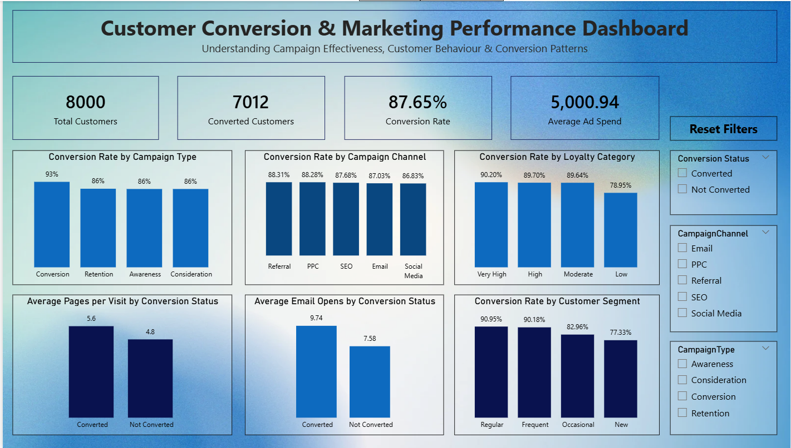

# Customer Conversion Intelligence Platform
An end-to-end data analytics project analyzing digital marketing campaign performance, customer engagement, and conversion patterns using Python, SQL Server, and Power BI.

## Project Overview

Analyzed **8,000 customer records across 20 attributes** to evaluate campaign performance, understand customer engagement, and identify conversion patterns.

## Tools & Technologies

- **Python:** Pandas, NumPy, Matplotlib, Seaborn
- **SQL:** SQL Server, SSMS
- **Visualization:** Power BI

## Project Workflow

1. **Python Analysis:** Data cleaning, EDA, feature engineering, and statistical hypothesis testing.
2. **SQL Analysis:** Joins, CTEs, subqueries, aggregations, customer segmentation, views, stored procedures, and user-defined functions.
3. **Power BI:** KPI monitoring, campaign performance analysis, customer engagement, and interactive filtering.

## Key Findings

- Overall observed conversion rate: **87.65%**.
- Conversion campaign category recorded **93.36%** conversion.
- Converted customers averaged 9.74 email opens, compared with 7.58 among non-converted customers.
- Regular customers recorded 90.95% conversion, compared with 77.33% among new customers.
- Above-average advertising spend customers showed 92.30% conversion, compared with 82.98% among average or below-average spend customers.

## Dashboard Preview

## Project Files

| File | Description |
|---|---|
| [Dataset](./digital_marketing_campaign_dataset.csv) | Source dataset |
| [Python Analysis](./Customer_Conversion_Analysis.ipynb) | Python notebook |
| [SQL Analysis](./Customer_Conversion_SQL_Analysis.sql) | SQL queries and analysis |
| [Power BI Dashboard](./Customer_Conversion_Dashboard.pbix) | Interactive dashboard |
| [Dashboard Image](./Customer_Conversion_Dashboard.png) | Dashboard screenshot |
| [Project Report](./Customer_Conversion_Intelligence_Project_Report.pdf) | Detailed project documentation |

## Limitations

- The dataset is synthetic.
- The overall conversion rate is unusually high.
- Revenue and profit data are unavailable for reliable ROI calculations.
- Findings represent observed associations, not causal relationships.

## Conclusion

This project demonstrates how Python, SQL Server, and Power BI can be used to transform customer data into meaningful business insights and support data-driven marketing analysis.

**Author:** Kritika Sharma

